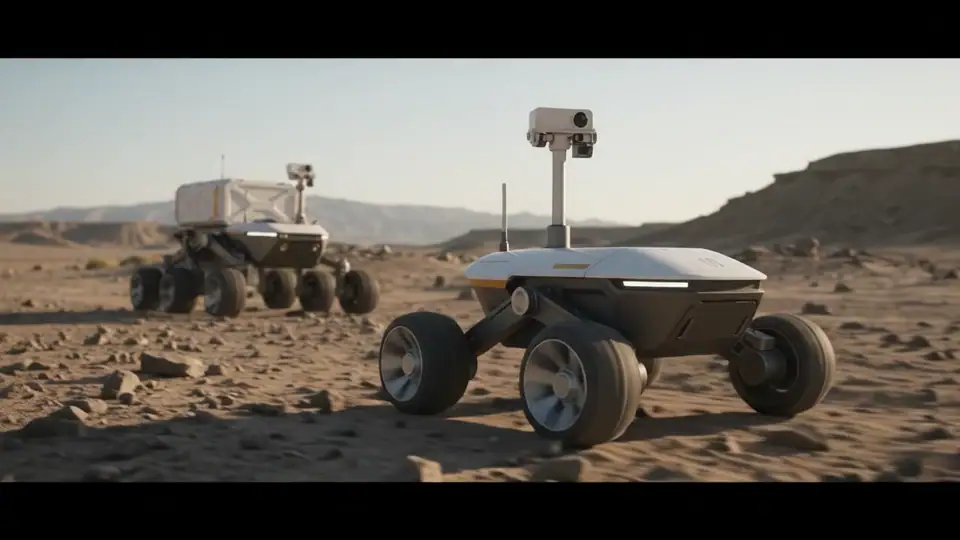
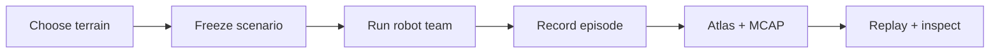

<div align="center">

<p><strong>R O C K E T &nbsp; A C A D E M Y</strong></p>

# FIRST CONTACT

**From planetary terrain to traceable robot experience.**

Explore worlds. Assemble a team. Record what happens next.

<p>
  <a href="#three-worlds-one-workspace">Explore the worlds</a> &nbsp; · &nbsp;
  <a href="#run-locally">Run locally</a> &nbsp; · &nbsp;
  <a href="docs/rocket-academy-planetary-training-platform-design.md">Read the vision</a>
</p>

<a href="docs/media/rocket-academy-first-contact.mp4">
  <picture>
    <source media="(prefers-reduced-motion: reduce)" srcset="docs/media/first-contact-poster.jpg">
    
  </picture>
</a>

**[▶ Watch the concept film with sound](docs/media/rocket-academy-first-contact.mp4)**<br>
10 seconds · 720p · Original MP4

<sub>The film presents the platform vision. Implemented capabilities and research milestones are listed below.</sub>

</div>

---

FIRST CONTACT is a planetary robotics workspace built around a simple idea: every mission should leave behind an inspectable record of where the robots were, what they observed, and how the episode was produced.

Move from a planetary globe to a local terrain patch. Compare real robot platforms, prepare a scenario, run two rovers together, and replay the recorded outcome. MongoDB Atlas connects the scenario, source assets and saved recording; MCAP carries the episode evidence into other tools.

| Worlds | Robot catalog | Shared simulation | Episode evidence |
| :---: | :---: | :---: | :---: |
| **Earth · Moon · Mars** | **30 platform profiles** | **2 independent robot instances** | **RGB · depth · states · sampled actions** |

## Three worlds. One workspace.

| Destination | Step onto the surface | Terrain foundation |
| --- | --- | --- |
| **MARS / DINGO GAP** | Explore Curiosity's rocky passage in Gale crater. A selectable marker on the Mars globe opens the local reconstruction. | NASA/JPL colorized ground reconstruction, streamed as 3D tiles |
| **MOON / APOLLO 17** | Traverse a 512 m patch in the Taurus–Littrow landing-site vicinity. | LROC NAC stereo terrain and matching orthophoto; 2 m elevation posts |
| **EARTH / AMBOY CRATER** | Build a terrestrial analog mission in the Mojave Desert. | USGS 3DEP 1 m elevation grid and USDA NAIP imagery; 512 m crop |

Pan, orbit and zoom through Three.js views. Choose a site from its globe marker or the world menu, then capture a complete **16 × 16 m terrain patch** for Robot lab. Source identity, hashes and coordinate conventions travel with the episode.

[Explore terrain provenance and coordinate frames →](docs/surface-sites.md)

## From a place to an episode

**01 — Choose your world.** Open the globe, enter a measured site, and select the patch that will define the simulation surface.

**02 — Assemble your team.** Browse humanoids, quadrupeds, mobile manipulators, companions, drones and field robots. Compare up to four platforms with dated specifications and source links. The current physics pilot runs **Clearpath Husky and Jackal**; either model can occupy either robot slot. Unitree Go2 supports 3D inspection.

**03 — Shape the scenario.** Prepare mission intent in Scenario Studio. Save a prompt brief, optionally import world-model reference media, and freeze a version tied to a terrain site and robot configuration. Gemini also supports structured planning in Mission tools.

**04 — Run, replay, retain.** Generate a shared-world MuJoCo episode, inspect the recorded trajectories and camera previews, and download MCAP. Atlas stores the scenario lineage, metadata and recording hashes; GridFS retains the recording bytes.



## Run locally

Use **Node.js 24**, npm, and a browser with WebGL hardware acceleration.

```bash
git clone https://github.com/k2jac9/rocket-academy-first-contact.git
cd rocket-academy-first-contact
npm ci
npm run dev
```

Open **[localhost:5173](http://127.0.0.1:5173)**. The app opens at Dingo Gap; the local API runs on port **8787**.

World exploration, the robot catalog and local kinematic mission tools work without service credentials. Globe images and the Moon/Earth site packages are bundled; Dingo Gap's streamed tiles need network access.

For saved physics episodes, configure **MongoDB Atlas** in `.env.local` and install the [Python simulation environment](simulation/README.md). Add `GEMINI_API_KEY` for optional AI planning. Keep credentials server-side.

| Setup | Guide |
| --- | --- |
| Atlas, Gemini, optional terrain access, controls and API | [Development guide](docs/developer-guide.md) |
| MuJoCo environment, robot assets and episode capture | [Simulation guide](simulation/README.md) |
| Connection diagnostics and verified recording reads | [Atlas connection checks](docs/atlas-connection.md) |

## What runs today

| Area | Current capability |
| --- | --- |
| **Worlds** | Earth, Moon and Mars globes; three local terrain sites; source-aware patch capture |
| **Robot catalog** | 30 profiles across six classifications; search, filters, 3D inspection where available, specification comparison and CSV export |
| **Physics pilot** | Two Husky/Jackal instances in one MuJoCo world; body-specific gravity; rigid terrain contact; simple virtual RGB/depth sensors |
| **Scenario Studio** | Exploration briefs, imported reference images/videos, provenance and immutable runnable pilot settings |
| **Atlas** | Saved runs, physical episodes and scenarios; hashed GridFS artifacts; active connection probes and bounded retry handling |
| **Replay and export** | Recorded poses, camera previews, local recovery artifacts and compressed physical-episode MCAP |

The physical pilot is experimental. Sensor calibration, planetary contact models and downstream policy training are still research milestones. Catalog membership does not imply a runnable robot model; household robots and standalone arms are excluded from the catalog.

**Google Genie:** the app supports versioned exploration briefs and media imports. Live world generation and automated robot control through Genie remain unverified. **Cosmos, Isaac Sim/Isaac Lab workers, governed training datasets and policy evaluation** are proposed extensions in the [platform design](docs/rocket-academy-planetary-training-platform-design.md).

## Built for the next iteration

| Layer | Implementation |
| --- | --- |
| Interactive workspace | React · TypeScript · Three.js · Vite |
| Local API and validation | Node.js 24 · shared TypeScript contracts |
| Physical execution | Python · MuJoCo |
| Mission planning | Deterministic baseline · optional Gemini |
| Episode memory | MongoDB Atlas · GridFS · SHA-256 lineage |
| Portable recordings | MCAP · explicit schemas, frames and timestamps |

```bash
npm test
npm run build
npm run check:atlas
```

The Atlas diagnostic checks the configured connection, indexes and representative recording hashes. Add `-- --write` for a temporary metadata/GridFS round trip with cleanup. See the [verification report](docs/atlas-connection.md) and [visual QA](design-qa.md) for dated evidence.

## Go deeper

| Explore | Read |
| --- | --- |
| Product architecture and the learning loop | [Platform design](docs/rocket-academy-planetary-training-platform-design.md) |
| Terrain sources, registration and reproducibility | [Surface sites](docs/surface-sites.md) |
| Genie boundaries and exploration provenance | [Google Genie integration](docs/google-genie-integration.md) |
| Physics scope and remaining milestones | [Synthetic episode lab](docs/synthetic-episode-lab.md) |
| Shared interface language | [Design system](docs/design-system.md) |
| Original film and preview details | [Media notes](docs/media/README.md) |

---

<div align="center">

**ROCKET ACADEMY · FIRST CONTACT**<br>
*A place to explore. An episode to learn from.*

[Apache-2.0](LICENSE) · [Data and asset credits](NOTICE.md) · [Repository](https://github.com/k2jac9/rocket-academy-first-contact)

</div>

Application code and source assets retain their respective licenses. This independent project does not imply endorsement by NASA, JPL, Google, MongoDB or other credited providers.
