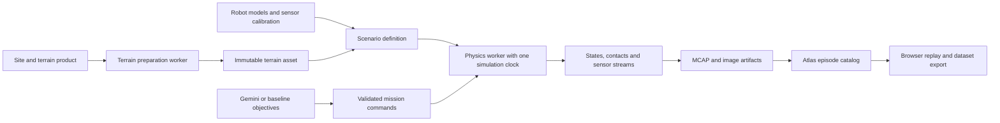

# Planetary robot simulation and synthetic episode generation

## Product target

The user wants different robots moving through realistic Mars, Moon, and Earth scenarios derived from topographic terrain maps, with episodes saved for robot training. The product is a scenario simulator and dataset generator. The planet viewer is the entry point for selecting sites.

The application now has two separate execution paths. Mission tools retain the single kinematic rover, Gemini planning and existing run contracts, with a source Husky visual model. Robot lab executes two independently selectable source Husky/Jackal models in one MuJoCo contact world, captures RGB/depth, saves episodes to Atlas/GridFS, and replays recorded poses. Its product library also offers Go2 inspection without a legged controller. The pilot uses a frozen 16 m Dingo Gap heightfield. Wheel control, virtual cameras, rigid wheels, uniform friction and simple rendering remain experimental. It is not yet a validated training environment. See [setup, contracts and checks](../simulation/README.md).

## Proposed first scenario

The user requested common real robot models, referenced Omblet, and prioritized fast, map-like Three.js navigation. The implemented library provides licensed source models, manufacturer identity, category/search controls, interactive inspection, and independent Husky/Jackal fleet selection. Dingo Gap is the first physics site; Moon and Earth remain globe/context views pending registered terrain adapters. The pilot records timestamped sampled actions, poses, velocities, contact counts, termination, and RGB/depth with explicit mathematical intrinsics/extrinsics. Physical sensor calibration and the downstream training interface are still outstanding.

Success is two independently controlled robots occupying the same simulated world, with robot/terrain and robot/robot contacts, replay from recorded states, and a downloadable episode whose terrain, robot configurations, and sensor models can be reconstructed exactly. Two copies of an independently generated path do not meet this milestone.

## Terrain preparation

Prepare an immutable local terrain asset from an original elevation product or a documented reconstruction. Store the original product identifier and URL, provider, license/attribution, checksum, body, coordinate reference and vertical datum, axis order, units, crop bounds, resolution, no-data mask, transform to the simulation frame, and preparation-tool version. Preserve hashes for both visual geometry and collision geometry.

Use a small local coordinate frame in metres for simulation. Keep its transform to the source frame and planetary coordinates where registration is known. Stop at missing or invalid terrain cells; never silently substitute a flat or randomly generated collision surface. Freeze collision resolution for the episode. Streamed visual tile detail must not decide robot contacts.

Candidate sources:

| World | Terrain source | Resolution implications |
| --- | --- | --- |
| Mars | [HiRISE stereo DTMs and orthoimages](https://hirise.lpl.arizona.edu/dtm/about.php); existing Dingo Gap reconstruction for a limited local pilot | HiRISE commonly provides 1–2 m post spacing. This does not resolve every wheel-scale obstacle. Dingo Gap's native frame has no verified geodetic registration in this app. |
| Moon | [LRO LOLA elevation products](https://pds-geosciences.wustl.edu/missions/lro/lola_faq.htm), with site-specific higher-resolution products selected where available | Read the individual product's sampling, uncertainty, reference surface, and coverage. A global elevation model is not a wheel-contact survey. |
| Earth | [NASADEM](https://developers.google.com/earth-engine/datasets/catalog/NASA_NASADEM_HGT_001) for context; a suitable surveyed local DEM/LiDAR product for contact-scale work | NASADEM's 30 m sampling cannot establish wheel-scale obstacle geometry. Select finer source data for the actual training site. |

Separate measured geometry from added synthetic rocks, roughness, lighting, and material parameters. Record those additions, distributions, and seeds. Do not describe inferred surface friction or generated sub-grid rocks as measured planetary facts.

## Execution architecture

Keep the React/Three.js client for selection, inspection, and replay; keep Node for validation, job management, and Atlas. Add an isolated simulation worker rather than running long physics and rendering jobs inside an HTTP request.

[MuJoCo](https://mujoco.readthedocs.io/en/stable/overview.html) 3.3.7 is installed in an isolated local Python environment and used by `simulation/worker.py`. Controlled contact, motion, shared-world collision, heightfield axes/scale, repeatability and camera depth checks pass. The worker uses a 5 ms timestep, a 200 Hz bounded lane controller, 10 Hz recorded state/action samples, and 2 Hz 128 × 96 RGB/depth. This laptop has an RTX 2060 with 6 GiB VRAM. Large-batch throughput and photorealistic sensors have not been benchmarked.

All robots share one world, terrain asset, body environment, and simulation clock. Each has a unique instance ID, immutable model revision, initial pose, controller, actuator limits, mass/inertia, joint configuration, collision geometry, and sensor calibration. Define actual differences between robot models; appearance alone is not a different dynamics model. Quadrupeds and drones require separate validated control and environment models. In particular, an Earth drone cannot be assumed to fly in lunar vacuum.

Gemini proposes tasks, waypoints, or bounded scenario parameters. It does not emit executable simulation code or replace a fixed-rate low-level controller. Validate outputs before creating a job. Keep planner provenance distinct from the controller and physics engine.

## Contracts and storage

New versioned records should be separate from existing v2 mission and v1 kinematic-run contracts:

| Record | Required identity and reproducibility fields |
| --- | --- |
| TerrainAsset | Source product/checksum, body/frame/units, crop and no-data policy, visual/collision artifact hashes, processing revision |
| RobotModel | Asset hash, model revision, geometry, mass/inertia/joints/actuators, controller contract, sensor definitions and calibration |
| Scenario | Terrain asset ID, robot instances, initial states, objectives, environment, randomization seed/distributions, duration and resource limits |
| Episode | Scenario hash, engine/version/build/platform, timestep, controller and planner provenance, termination, integrity and validation results, artifact references |
| DatasetManifest | Explicit episode IDs, observation/action schema, split assignment, filters, transformations, checksums and provenance |

Suggested API boundary: `POST /api/terrain-assets`, `POST /api/scenarios`, `POST /api/episodes`, `GET /api/episodes/:id`, `GET /api/episodes/:id/artifacts`, and `POST /api/datasets`. Terrain imports must use vetted source adapters or local uploads; an arbitrary URL downloader must not become an unbounded server fetch facility. Episode creation returns a job ID; states progress through queued/running/complete/failed/cancelled. Retry by idempotency key without creating duplicate episodes. Partial artifacts never appear as complete episodes.

Atlas stores searchable metadata, scene/robot/scenario versions, status, metrics, and artifact references. Small MCAP artifacts can use existing GridFS. Choose an object store for larger image/video datasets once actual sizes are measured; do not put unbounded image arrays into episode documents.

Use robot-specific channels such as `/robots/{id}/joint_states`, `/robots/{id}/action`, `/robots/{id}/pose`, `/robots/{id}/contacts`, `/robots/{id}/camera/rgb`, and `/robots/{id}/camera/depth`, plus transforms, simulation clock, scene identity, and outcomes. Record camera intrinsics/extrinsics, depth units, sensor timestamps/rates, segmentation label mapping, and any noise/latency models. Keep simulated ground truth separate from noisy observations. Export training-framework-specific data through adapters; retain MCAP and a versioned dataset manifest as the auditable episode source.

## Validation gates

1. Terrain sampling, scale, axes, origin, and no-data behavior match the original product and recorded transforms. Visual and collision geometry align.
2. Controlled flat-ground, slope, static-contact, braking, and collision cases match declared expectations within documented tolerances. Check timestep sensitivity, body gravity, and robot/robot contact.
3. Replaying an episode uses stored states, not a new planner call. Repeatability is measured under a pinned engine/build/platform with tolerances; do not promise cross-platform bitwise determinism.
4. Camera projection and depth agree with known geometric targets. Verify timestamps, rates, coordinate transforms, and labels for every robot.
5. Independently read recordings; verify schema, CRC/hash, monotonically increasing simulation time, unique robot IDs, no missing required channels, and artifact consistency.
6. Split datasets by terrain site and scenario family before augmentation so near-duplicate trajectories cannot leak across training and evaluation sets.
7. Evaluate a concrete downstream model on held-out scenarios. Synthetic data usefulness and transfer to a physical robot require evidence; photorealistic appearance and a valid MCAP are insufficient.

## Delivery order

1. Make the existing rover visible before execution, at a readable size, with a deployment preview and camera recovery control. Verify movement through recorded replay. Implemented locally in this change.
2. Freeze a complete real Dingo Gap crop. Implemented as 4,225 resident-mesh ray samples with source revision, transform, capture detail and hash; no missing-cell filling. The sample spacing is not a claim of source measurement accuracy.
3. Run two actual robot instances in one physics worker with bounded control, shared time and collision handling. Implemented for source Husky/Jackal models, retaining legacy four/six-wheel generic recordings.
4. Record sensor streams and sampled state/action pairs; replay and save complete episodes in Atlas. Implemented for simple-material RGB and clean depth, with mathematical camera calibration. Physical calibration and dataset usefulness remain unvalidated.
5. Add repeatable scenario batches, dataset manifests, split controls and evaluation.
6. Extend to Moon/Earth sources and additional robot classes after the corresponding source, dynamics and sensor checks pass.

Revisit asset storage, durable distributed job scheduling, rendering throughput, authentication and compute placement when moving beyond local development. The current job runner is a bounded local process, not a production worker queue. The application keeps the map and lab mounted when switching views, pauses offscreen scene rendering, bundles the Mars overview texture, and provides pan/orbit/cursor zoom controls. Further work remains on tiled-data caching, progressive level-of-detail transitions, frame-rate profiling, and registered Moon/Earth physics sites.

## Measured Moon and Earth sites

The same capture/record workflow now supports Apollo 17 (LROC 2 m DTM) and Amboy Crater (USGS 1 m DEM). Their local frames, source hashes and body-specific gravity are recorded. See [surface-site provenance](surface-sites.md). Original Mars-only validation below is historical evidence, not a substitute for these source-specific checks.
